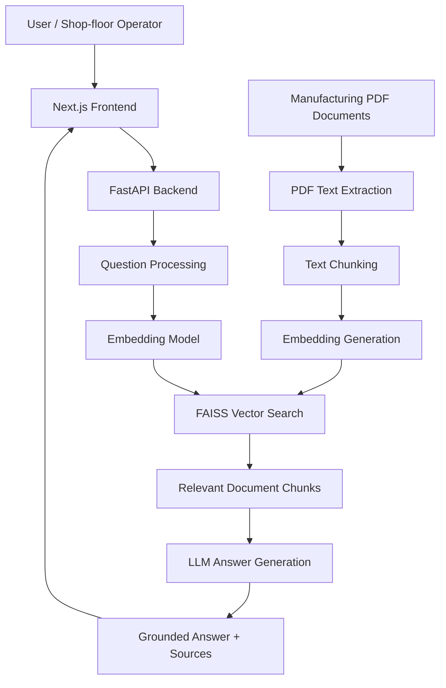
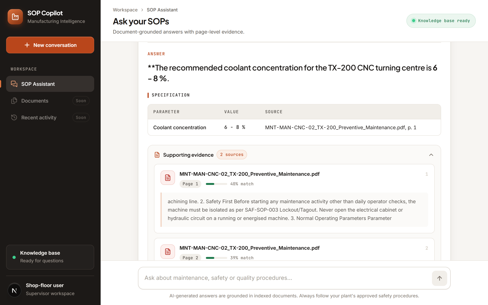
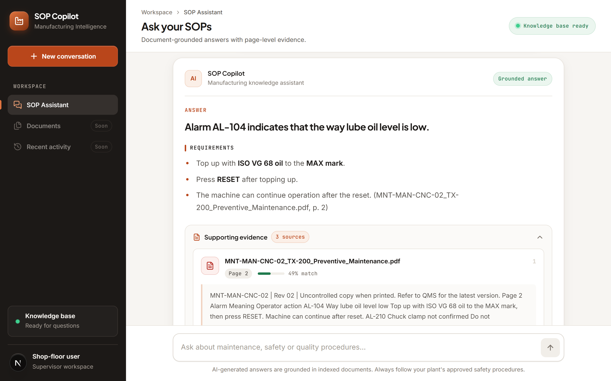
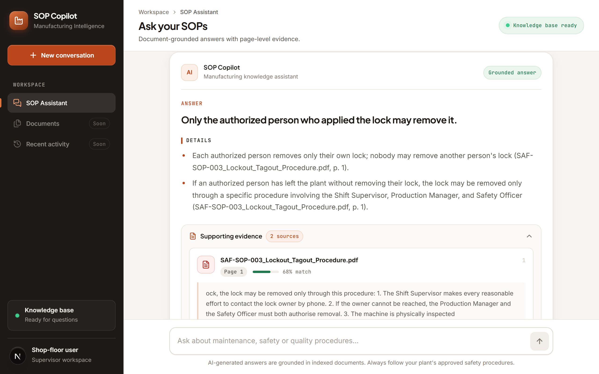
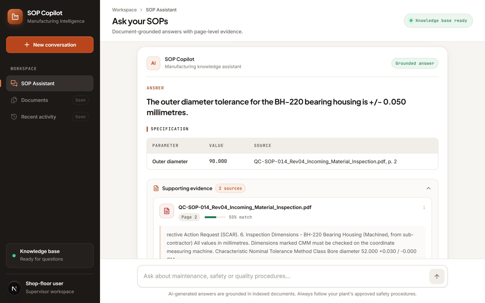
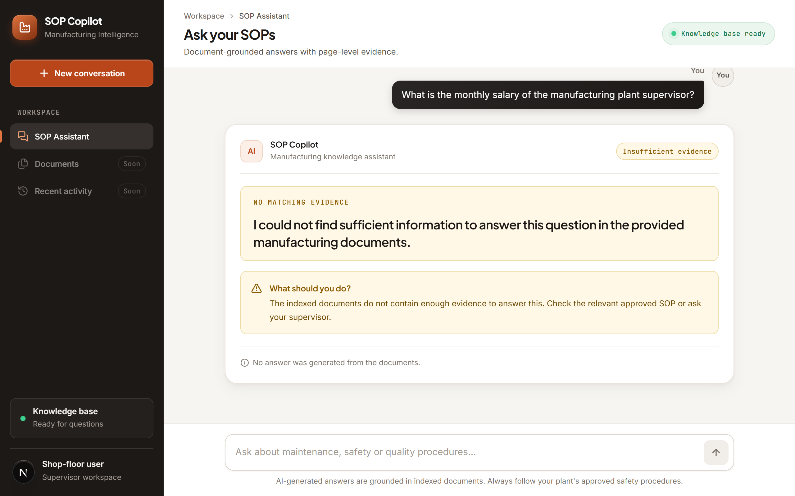

# Manufacturing SOP Copilot

An AI-powered manufacturing knowledge assistant that helps shop-floor operators, maintenance technicians, and supervisors find information from manufacturing Standard Operating Procedures (SOPs) and technical documents.

Instead of manually searching through lengthy PDF documents, users can ask questions in natural language and receive answers grounded in the provided documents, along with document and page references.

## 1. Project Overview

Manufacturing teams regularly refer to SOPs, maintenance manuals, and quality-control documents to find operational information. Searching these documents manually can take time, especially when users need a specific measurement, inspection requirement, or maintenance procedure.

**Manufacturing SOP Copilot** addresses this problem through a Retrieval-Augmented Generation (RAG) application.

A user asks a question through the chat interface. The backend retrieves relevant passages from the indexed PDF documents and provides them to an LLM. The model generates an answer using the retrieved evidence.

### Key Features

- Ask manufacturing-related questions using natural language.
- Retrieve relevant information from uploaded PDF documents.
- Generate answers using retrieved document context.
- Display supporting document names and page references.
- Show relevant evidence excerpts.
- Abstain when the provided documents do not contain sufficient information.
- Provide a responsive interface that can also be tested from a phone on the same local network.

### Example Use Case

A maintenance technician wants to know a preventive maintenance requirement.

Instead of opening multiple PDF files and searching manually, the technician asks the Copilot a question. The application searches the indexed documents and returns an answer with supporting references.

## 2. Architecture

The application follows a Retrieval-Augmented Generation (RAG) architecture.



### How the Application Works

**Step 1 — Document ingestion**

The backend reads the manufacturing PDF documents and extracts their text page by page.

**Step 2 — Text chunking**

The extracted text is divided into smaller chunks. Each chunk retains metadata such as its source document and page number.

**Step 3 — Embedding generation**

A Sentence Transformers embedding model converts each text chunk into a numerical vector representation.

**Step 4 — Vector indexing**

The generated embeddings are stored in a FAISS vector index to support similarity-based retrieval.

**Step 5 — Question retrieval**

When a user asks a question, the backend converts the question into an embedding and searches the vector index for relevant chunks.

**Step 6 — Answer generation**

The retrieved chunks are passed to the LLM as context. The model is instructed to answer using the supplied manufacturing documents rather than unsupported external knowledge.

**Step 7 — Evidence and response**

The backend returns the answer, source document information, page references, and abstention status. The frontend displays the response in a structured format.

## 3. Technology Stack

| Layer | Technology | Purpose |
|---|---|---|
| Frontend | Next.js | Chat interface |
| Frontend language | TypeScript | Type-safe application development |
| Styling | CSS / Tailwind CSS | Responsive user interface |
| Backend | Python, FastAPI | REST API and RAG pipeline |
| PDF processing | PyMuPDF | Extract text from PDF documents |
| Embeddings | Sentence Transformers | Convert text into vectors |
| Embedding model | all-MiniLM-L6-v2 | Semantic text embeddings |
| Vector search | FAISS | Similarity-based retrieval |
| LLM | OpenAI API | Generate grounded responses |
| LLM model | gpt-4o-mini | Answer generation |

## 4. Project Structure

```text
manufacturing-sop-copilot/
│
├── backend/
│   ├── app/
│   │   ├── rag/
│   │   │   ├── pdf_loader.py
│   │   │   ├── chunker.py
│   │   │   ├── embeddings.py
│   │   │   ├── retriever.py
│   │   │   └── generator.py
│   │   └── main.py
│   │
│   ├── data/
│   │   └── manufacturing PDF documents
│   ├── .env
│   └── requirements.txt
│
├── frontend/
│   ├── src/
│   │   ├── app/
│   │   ├── components/
│   │   ├── lib/
│   │   └── types/
│   ├── .env.local
│   └── package.json
│
├── README.md
└── THINKING.md
```

## 5. Installation and Setup

### Prerequisites

Install the following before running the application:

- Python 3.10 or later (use the version supported by the project dependencies).
- Node.js and npm.
- Git.
- An OpenAI API key.

### Clone the Repository

```bash
git clone https://github.com/Madesh-cse/SOP-Copilot
cd manufacturing-sop-copilot
```

### Backend Setup

Open a terminal in the backend directory:

```bash
cd backend
```

Create a virtual environment:

```bash
python -m venv venv
```

Activate it on Windows PowerShell:

```powershell
.\venv\Scripts\Activate.ps1
```

Install dependencies:

```bash
pip install -r requirements.txt
```

Add the required environment variables to the backend `.env` file.

### Frontend Setup

Open another terminal:

```bash
cd frontend
```

Install dependencies:

```bash
npm install
```

Create the `.env.local` file and configure the backend API URL.

## 6. Environment Variables

### Backend — `backend/.env`

Configure the variables used by the backend configuration:

```env
OPENAI_API_KEY=your_openai_api_key
OPENAI_MODEL=gpt-4o-mini
EMBEDDING_MODEL=sentence-transformers/all-MiniLM-L6-v2
MIN_SIMILARITY=0.30
```

**Note:** Confirm the variable names against the backend configuration before publishing. If your code uses different names, update this example to match the actual implementation.

Never commit `.env` files or expose API keys in the repository.

### Frontend — `frontend/.env.local`

```env
NEXT_PUBLIC_API_URL=http://127.0.0.1:8000
```

For phone testing over the same Wi-Fi network, replace `127.0.0.1` with your development computer's local network IP address.

## 7. How to Run the Application

Run the backend and frontend in separate terminals.

### Start the Backend

```bash
cd backend
```

Activate the virtual environment:

```powershell
.\venv\Scripts\Activate.ps1
```

Start FastAPI:

```bash
uvicorn app.main:app --reload
```

Backend:

```text
http://127.0.0.1:8000
```

Interactive API documentation:

```text
http://127.0.0.1:8000/docs
```

### Start the Frontend

```bash
cd frontend
npm run dev
```

Frontend:

```text
http://localhost:3000
```

### Phone Testing

To test the application from a phone connected to the same Wi-Fi network:

1. Find the local IPv4 address of your development computer.
2. Configure the frontend API URL to use that address.
3. Start the backend with `--host 0.0.0.0`.
4. Start the frontend with `--hostname 0.0.0.0`.
5. Allow the required ports through the Windows private-network firewall.
6. Open `http://YOUR_COMPUTER_IP:3000` on the phone.

Ensure the backend CORS configuration permits the frontend's LAN origin. This is for local development and demonstration, not a production deployment configuration.

## 8. API Documentation

The backend exposes REST API endpoints through FastAPI.

### Health Check

**Endpoint**

```http
GET /api/health
```

**Purpose**

Checks whether the backend service is running.

**Example**

```bash
curl http://127.0.0.1:8000/api/health
```

### Document Ingestion

**Endpoint**

```http
POST /api/ingest
```

**Purpose**

Loads and processes the manufacturing PDF documents, creates text chunks, generates embeddings, and builds the vector index.

Use the interactive FastAPI documentation at `/docs` to inspect the actual request format and response.

### Chat

**Endpoint**

```http
POST /api/chat
```

**Purpose**

Accepts a user's question, retrieves relevant document chunks, generates an answer, and returns supporting sources.

**Illustrative request**

```json
{
  "question": "What is the preventive maintenance requirement?"
}
```

**Illustrative response structure**

```json
{
  "question": "What is the preventive maintenance requirement?",
  "answer": "Answer generated from the retrieved document context.",
  "sources": [
    {
      "document": "sample-maintenance-sop.pdf",
      "page": 2,
      "similarity": 0.72,
      "excerpt": "Relevant text extracted from the document..."
    }
  ],
  "abstained": false
}
```

The response above illustrates the intended structure. Confirm the exact request and response fields using the running API and its `/docs` page.

## 9. Five Original Questions and Actual Application Answers

The following questions should demonstrate different types of manufacturing-document queries.

**Important:** Run each question in the actual application. Copy the application's answer and source references into the corresponding answer section. Do not write an answer based only on what you expect the model to return.

### Question 1

**Question:**  
1.What is the recommended coolant concentration for the TX-200 CNC turning centre?

**Actual application answer:**



**Retrieved source:**  
[Document name and page number.]

### Question 2 
The machine is showing alarm AL-104. What does it mean and what should the operator do?

**Actual application answer:**



**Retrieved source:**  

### Question 3 

Who is allowed to remove a lockout lock from a machine?

**Actual application answer:**



### Question 4 — Operational Procedure

What is the outer diameter tolerance for the BH-220 bearing housing?

**Actual application answer:**



### Question 5 — Unsupported / Unanswerable Question

What is the monthly salary of the manufacturing plant supervisor?

**Actual application answer:**



**Expected behavior:**  
The application should communicate that the supplied documents do not contain sufficient information to answer the question. It should not invent a procedure, measurement, or requirement.

## 10. Limitations

The current implementation has the following limitations:

1. **PDF text extraction:** Scanned PDFs and image-based documents may require OCR support.
2. **Retrieval quality:** The quality of the answer depends on document quality, chunking, embeddings, and retrieval relevance.
3. **Similarity score:** A vector similarity score indicates retrieval similarity; it is not a calibrated measure of answer correctness or confidence.
4. **Context limitations:** Relevant information spread across multiple sections or documents may not always be retrieved together.
5. **Document updates:** The current in-memory vector index needs to be rebuilt when the backend restarts or documents change.
6. **LLM limitations:** The model may still produce an incorrect or incomplete answer despite grounding instructions. Important operational information must be checked against approved SOPs.
7. **Authentication:** Production use requires appropriate authentication, authorization, and access controls.
8. **Scalability:** The current implementation is intended as a demonstration and would need persistent vector storage, monitoring, and deployment improvements for larger-scale usage.

## 11. Future Improvements

- Add OCR for scanned manufacturing documents.
- Add document upload and document-management functionality.
- Improve retrieval with metadata filtering and hybrid search.
- Add stronger evidence validation before returning answers.
- Introduce persistent vector storage and document versioning.
- Add user authentication and role-based access control.
- Add feedback collection to evaluate answer quality.
- Add production monitoring, logging, and deployment infrastructure.

## 12. Safety and Responsible Use

This application is designed to assist users in locating information from manufacturing documents. It is not a replacement for approved operating procedures, qualified maintenance personnel, or supervisor approval.

Users should verify critical measurements, safety instructions, and operational decisions against the latest approved plant documentation before taking action.
