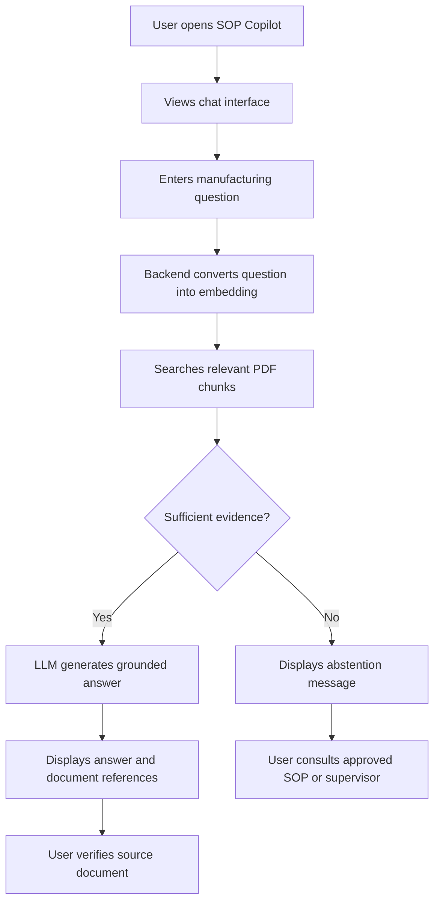

# Product Thinking — Manufacturing SOP Copilot

## 1. Understanding the User

Before designing the application, I considered who would use it and what problem they were trying to solve.

### Primary Users

| User | Need | Challenge |
|---|---|---|
| Shop-floor Operator | Find operating instructions quickly | May not know which document contains the required information |
| Maintenance Technician | Find maintenance procedures and requirements | Needs accurate technical information |
| Quality Inspector | Verify measurements and inspection criteria | Needs exact values and document references |
| Production Supervisor | Access reliable SOP information | Needs information that can be verified before making decisions |

### Problem Statement

Manufacturing organizations maintain important operational knowledge in PDFs, SOPs, maintenance manuals, and quality-control documents.

Finding a particular instruction or specification manually can take time. Users may need to search through multiple documents and pages before locating the relevant information.

The problem is not simply that documents contain too much text. The challenge is helping users find the correct information quickly while maintaining traceability to the original document.

### Product Goal

Build a simple AI-powered assistant that allows manufacturing personnel to ask questions in natural language and receive answers grounded in the available manufacturing documents.

The application should prioritize:

- Accuracy over answer creativity.
- Evidence over unsupported assumptions.
- Clear answers over unnecessary technical explanations.
- Source references over answers without traceability.
- Abstention over guessing when evidence is insufficient.

## 2. First-Draft User Journey

My initial user journey was designed around the most common task: finding information in manufacturing documents.

### User Journey Explanation

**1. Open the application**

The user opens the application and sees a straightforward chat interface.

**2. Ask a question**

The user enters a question related to maintenance, inspection, specifications, or manufacturing procedures.

**3. Retrieve relevant information**

The backend searches the indexed manufacturing documents using semantic similarity.

**4. Generate the answer**

Relevant document chunks are passed to the LLM as context.

**5. Review the response**

The user receives a structured response with supporting document and page references.

**6. Handle unsupported questions**

If the available documents do not provide sufficient information, the application should abstain instead of generating an unsupported answer.

## 3. Skeptical AI Critique and Conversation Excerpts

I used AI as a critical reviewer during development rather than treating every suggestion as automatically correct.

The following are representative excerpts and the engineering questions they raised during the design process.

### Critique 1 — Is a generated answer necessarily correct?

**Design concern:**

A language model can produce a convincing answer even when the retrieved document passages do not fully support it.

**Discussion:**

The answer-generation prompt needs strict grounding instructions. The model should use only the retrieved context, preserve technical values and units, and abstain when evidence is insufficient.

**My takeaway:**

A well-written answer is not necessarily a correct answer. For manufacturing applications, evidence is more important than presentation.

### Critique 2 — Does similarity score mean answer confidence?

**Design concern:**

A high retrieval similarity score does not prove that the generated answer is factually correct.

**Discussion:**

The embedding similarity score measures how closely the question matches a retrieved text chunk in vector space. It is not a calibrated probability that the answer is correct.

**My decision:**

Display retrieval similarity as a match indicator where useful, but do not label it as answer confidence.

### Critique 3 — Are all retrieved sources actually supporting the answer?

**Design concern:**

Displaying every retrieved chunk as a source may create a misleading impression that every source supports every statement in the answer.

**Discussion:**

Source relevance should be evaluated separately from answer generation. Ideally, each important claim should be supported by the corresponding document passage.

**My takeaway:**

A source card should provide useful evidence, not simply show that a document was retrieved.

### Critique 4 — Is the interface suitable for shop-floor users?

**Design concern:**

A technically functional chatbot may still be difficult to use if answers are presented as large blocks of unstructured text.

**Development feedback:**

During frontend development, I identified that the answer needed clearer sections, readable Markdown, visible supporting evidence, and a more organized layout.

**My decision:**

Improve the answer presentation without sacrificing the simplicity of the chat experience.

## 4. What I Agreed and Disagreed With

AI suggestions were treated as recommendations that needed engineering judgment.

| Area | What I agreed with | What I questioned or disagreed with |
|---|---|---|
| Answer generation | Use retrieved document context to ground answers | A prompt alone cannot guarantee factual correctness |
| Retrieval | Use semantic search for natural-language questions | Similarity score should not be treated as answer confidence |
| Sources | Show document names and page references | Showing all retrieved chunks does not prove claim-level support |
| Abstention | Return a clear message when evidence is insufficient | A fixed similarity threshold alone may not identify every unsupported question |
| Interface | Use structured answers and readable formatting | More visual elements do not automatically make an interface easier to use |

### Engineering Principle

I agreed with suggestions that improved reliability, usability, and traceability. I questioned suggestions that could create false confidence or hide the limitations of the retrieval process.

## 5. Improvements Implemented and Rationale

The following improvements were made during development.

### Improvement 1 — Structured Answer Presentation

**Initial problem:**

Answers could appear as unstructured text, making technical information difficult to scan.

**Implementation:**

- Added structured answer sections.
- Added Markdown rendering.
- Improved heading, list, and table presentation.
- Separated the answer from supporting evidence.
- Added a visible abstention state.

**Why:**

Shop-floor users should be able to identify the direct answer and important supporting details quickly.

### Improvement 2 — Supporting Evidence

**Initial problem:**

An answer without a clear document reference is difficult to verify.

**Implementation:**

The response includes source information such as:

- Document name.
- Page number.
- Retrieved text excerpt.
- Retrieval similarity score, where available.

**Why:**

Users can trace an answer back to the original manufacturing document.

### Improvement 3 — Grounded Answer Generation

**Initial problem:**

An LLM may generate information that is not present in the supplied documents.

**Implementation:**

The answer-generation prompt includes instructions to:

- Answer only from the retrieved context.
- Avoid inventing measurements, units, and procedures.
- Preserve technical values from the documents.
- Identify conflicting information when it is visible in the retrieved context.
- Abstain when the available evidence is insufficient.

**Why:**

Manufacturing information can affect quality, maintenance, and operational decisions. Unsupported answers should not be presented as established instructions.

### Improvement 4 — Abstention Handling

**Initial problem:**

The application should not attempt to answer every question.

**Implementation:**

Added an explicit abstention response for questions where the application does not have sufficient retrieved information.

**Why:**

A transparent statement that the documents do not contain sufficient information is preferable to an invented answer.

### Improvement 5 — Responsive and Organized Interface

**Initial problem:**

The interface needed to be comfortable to use on both desktop and mobile screens.

**Implementation:**

- Added a structured sidebar and main chat area.
- Kept the sidebar fixed while the conversation area scrolls.
- Improved message and evidence presentation.
- Added responsive layout behavior.

**Why:**

The application should remain usable on different screen sizes, including a phone connected to the same local network.

## 6. Final Reflection

Building Manufacturing SOP Copilot helped me understand that developing an AI application involves more than connecting an LLM to a frontend.

The most important engineering challenge was designing a reliable flow between document processing, text chunking, embedding generation, vector retrieval, and answer generation.

I learned that retrieval quality directly affects the usefulness of generated answers. I also learned that similarity scores should not be confused with factual confidence and that source references are important for making AI responses verifiable.

Another important lesson was that prompt engineering alone is not a complete solution to hallucination. A reliable system also needs appropriate retrieval thresholds, evidence validation, abstention handling, and testing against questions that are both answerable and unanswerable.

### What I Would Improve Next

If I continued developing this project, my next priorities would be:

1. Evaluate retrieval quality using a collection of questions with known supporting pages.
2. Improve retrieval using metadata filtering and hybrid search.
3. Validate whether each answer claim is supported by its cited evidence.
4. Add OCR support for scanned manufacturing PDFs.
5. Introduce persistent vector storage and document versioning.
6. Add authentication, role-based access, and production monitoring.
7. Collect user feedback to measure answer usefulness and retrieval quality.

### Final Takeaway

My main takeaway is that an AI assistant for manufacturing should not be judged only by how naturally it answers questions. It should be judged by whether its answers are supported by the right documents, whether users can verify the information, and whether it knows when not to answer.

That principle guided the design decisions throughout this project.
